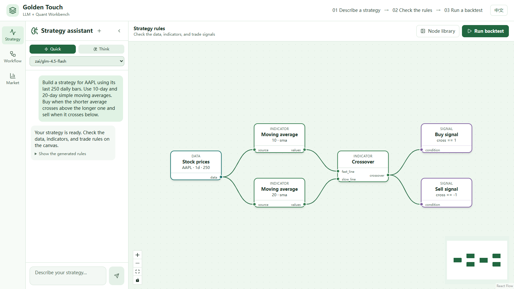
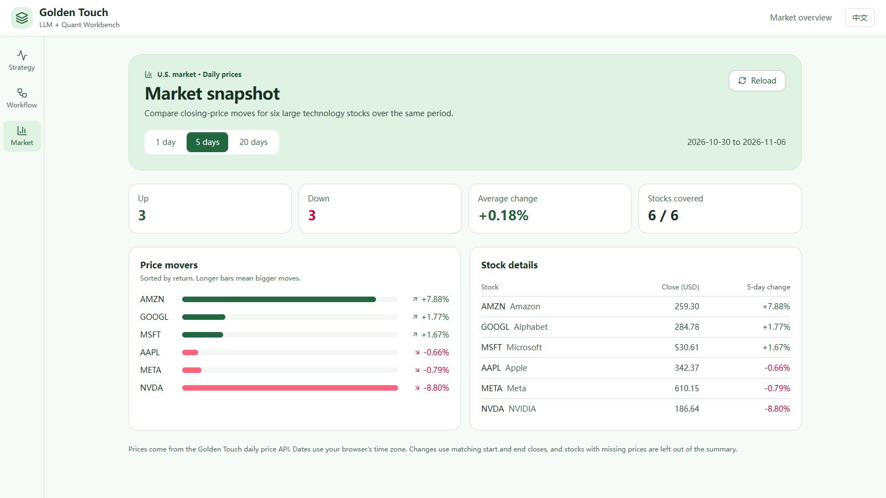
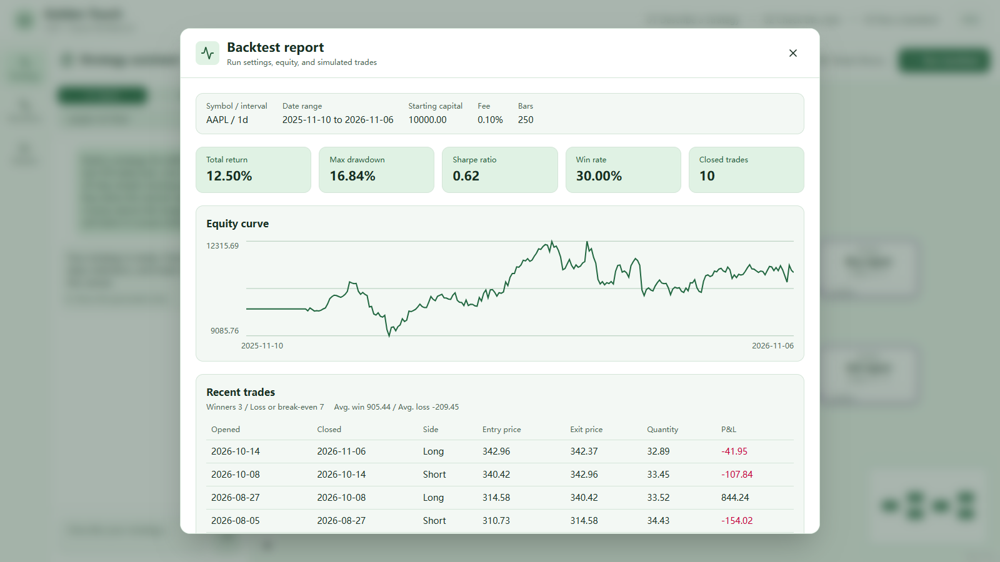

# Golden Touch · LLM + Quant

## LLM + Quant Demo

Golden Touch is a workbench for turning a natural-language trading rule into an inspectable strategy and running it on historical market data. This demo uses an AAPL daily 10/20-day moving-average crossover.

### Screenshots

**Strategy workbench** · Describe a trading idea and review the generated rules.



**Market snapshot** · Compare six stocks over the same trading window.



**Backtest report** · Review the run settings, equity curve, and trades.



### Run locally

Use two PowerShell terminals from the repository root. The demo setup uses Python 3.12, Node.js 22, SQLite, your own Zhipu API key, and Yahoo Finance historical prices.

**Terminal 1 · API**

```powershell
python -m venv .venv
.\.venv\Scripts\python.exe -m pip install -r requirements-demo.txt
Set-Location backend
```

Create `backend/.env` with the following settings and replace the key placeholder with your own key.

```dotenv
DATABASE_URL=sqlite+aiosqlite:///./sql_app.db
US_STOCK_DATA_PROVIDER=yfinance
LLM_DEFAULT_MODEL=zai/glm-4.5-flash
LLM_AVAILABLE_MODELS=zai/glm-4.5-flash
ZAI_API_KEY=your-key-here
```

From `backend/`, start the API in UTF-8 mode for Windows console output.

```powershell
..\.venv\Scripts\python.exe -X utf8 -m uvicorn app.main:app --host 127.0.0.1 --port 8000
```

**Terminal 2 · Web interface**

```powershell
Set-Location frontend
npm ci
npm run dev -- --host 127.0.0.1 --strictPort
```

Open `http://127.0.0.1:3000`. Click **Try the AAPL example**, send the prompt, check the moving averages and buy/sell rules, then click **Run backtest**. The workbench opens in English. Click **中文** in the header, or open `http://127.0.0.1:3000/?lang=zh`, for the Chinese interface. The report uses the latest available daily bars, so the history window and metrics can change when you rerun it. This local path runs without Docker or a Celery worker.

Use the **Market** view to compare the same 1-, 5-, or 20-session closing-price window across six US technology stocks. It reads the existing K-line API and shows the dates and coverage of each comparison.

The full backend setup is described below.

## 🚀 Core Capabilities

- **NL2DAG**: Generate executable strategy DAGs directly from natural language.
- **Logic Injection**: LLM automatically writes Python code (`logic.code`) when standard library lacks required logic.
- **Graph Bundle Architecture**: Separates strategy definition (`graph.yaml`) from prompts (`assets/*.txt`), supporting complex "Think → Plan → Build" workflows.
- **Smart Validation**: Memory-enabled validation system that captures errors and guides LLM self-correction.
- **Data Persistence**: Complete history, session management, and graph storage (PostgreSQL + SQLAlchemy/SQLModel).
- **Async Execution**: Distributed task execution engine based on Celery + Redis for long-running backtest tasks.

## 🏗️ Architecture

### 1. Node System
Hierarchical design from coarse to fine:
- **Structure**: `composite`, `input`, `output` (for building subgraphs/nested graphs)
- **Flow**: `retry`, `if`, `merge` (control flow)
- **Logic**: `script_node` (safe sandbox code execution), `condition`
- **Indicator**: `ma`, `rsi`, `bollinger`, `crossover` (smart data alignment)
- **Data**: `fetch_crypto` (supports 100+ exchanges)
- **Agent**: Intelligent agent nodes supporting ReAct/Plan-and-Solve patterns.

### 2. Generation Engine
Located at `backend/graphs/standard/`:
- **Standard Strategy Builder**: 
    - Retriever: Dynamically retrieves available tools.
    - Chain: Prompt → LLM → Code Output → CodeToDAG → Validation → Retry.
    - Memory: Automatically accumulates validation errors for LLM in retry loop.

## 🛠️ Tech Stack

- **Backend**: Python 3.10+, FastAPI, SQLModel (ORM), Alembic (Migrations), Celery (Async Tasks).
- **Core Libraries**: LangChain, LangGraph, Pandas-TA, Backtrader (Engine).
- **Infrastructure**: PostgreSQL (or SQLite for local), Redis (for Celery broker).

## 🏁 Quick Start

### 1. Environment Setup

```bash
cd backend

# Install dependencies
pip install -e .

# Configure environment
cp example.env .env
# Edit .env to fill in ZHIPU_API_KEY, REDIS_URL, DATABASE_URL, etc.
```

#### Database (Optional but Recommended)
Although the system auto-initializes SQLite, it's recommended to establish proper migration history:
```bash
alembic upgrade head
```

### 2. Start Services

**Windows:**
```bash
start_app.bat
```

**Linux/macOS:**
```bash
chmod +x start_app.sh stop_app.sh
./start_app.sh
```

This starts the Backend API on Port 8000.

*(Note: Ensure Redis is running, or configure properly in .env)*

### 3. Manual Component Startup

**Start API Server:**
```bash
cd backend
uvicorn app.main:app --reload --port 8000
```

**Start Celery Worker (for async backtest/execution):**
```bash
cd backend
celery -A app.core.celery_app worker --loglevel=info -P solo
```
*(On Windows, use `-P solo` or `-P gevent` to avoid process creation issues)*

## 🧪 Testing & Development

### CLI Client
Experience the full workflow (Generate → Build → Execute):
```bash
python backend/tests/run_graph_client.py
```
> Select Mode 1 (Fast Mode) and enter a strategy description, e.g.: "Buy BTC if MA5 > MA20".

### E2E Tests
Verify system integrity:
```bash
python backend/tests/test_e2e_execution.py
```

## 📝 Changelog

- **v0.2.0**: 
    - Refactored Graph Client to interactive CLI.
    - Introduced `logic.code` replacing old Sandbox, supporting soft sandbox isolation.
    - Enhanced `CodeToDAG` parsing with automatic port inference (`input`/`value`/`data`).
    - Improved indicator nodes (`ma`, `crossover`) robustness for mixed data types (`List[Dict]`).
    - Added persistence layer (SQLModel + Alembic) and async task support (Celery).

<sub>HKUST(GZ) · INFH 5000 · Cohort 2026 · Group 18 course project</sub>
